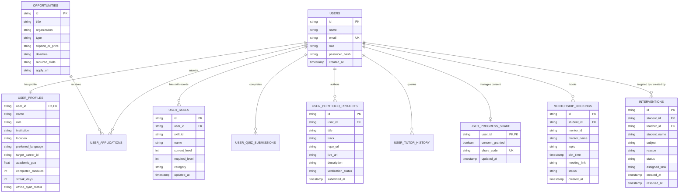

# Database Architecture & Data Model (DATABASE.md)

## Project Title: Tatva (CareerGrowth)
**AI-Powered Integrated Education, Skill & Employability Platform — From Learning to Livelihood**  
**Role:** Senior Database Architect & Backend Data Engineer  
**Version:** 1.0.0 (Production Data Specification)  
**Status:** Approved Schema Definition  

---

## 1. Database Technology & Storage Architecture

### 1.1 Dual-Tier Storage Strategy
Tatva utilizes a production-engineered **Atomic JSON Datastore** for MVP simplicity, portability, and zero-dependency local/edge deployments, paired with a standardized **PostgreSQL Relational Target Schema** for enterprise multi-college scaling.

1. **Active Storage Engine (Node.js Atomic POSIX Store):**
   - File Path: `server/database.json`
   - Seed Blueprint: `server/database.seed.json`
   - Concurrency & Crash Resistance: Mutating transactions execute in memory and flush to disk via atomic write-and-rename:
     ```js
     const tmpPath = `${DB_PATH}.tmp.${Date.now()}`;
     fs.writeFileSync(tmpPath, JSON.stringify(db, null, 2), 'utf8');
     fs.renameSync(tmpPath, DB_PATH);
     ```
   - In-memory lock guards ensure sequential write operations without race conditions.

2. **Enterprise Scale Target (PostgreSQL 16+):**
   - Direct 1:1 entity-relational schema mapping.
   - ACID transaction compliance with Connection Pooling via `pg-pool`.

---

## 2. Entity-Relationship (ER) Diagram



---

## 3. Relational Table Definitions & Data Dictionary

### 3.1 Table: `users`
Core identity table storing credentials and system privileges.
| Column | Type | Constraints | Description |
|---|---|---|---|
| `id` | `VARCHAR(64)` | `PRIMARY KEY` | Unique user identifier (`usr-*` or UUID). |
| `name` | `VARCHAR(128)` | `NOT NULL` | Display name of the account holder. |
| `email` | `VARCHAR(255)` | `NOT NULL, UNIQUE` | Normalized lowercase login email. |
| `role` | `VARCHAR(32)` | `NOT NULL` | One of `'student'`, `'teacher'`, `'admin'`. |
| `password` | `VARCHAR(255)` | `NOT NULL` | Salted bcrypt hash ($rounds \ge 10$). |
| `createdAt` | `TIMESTAMPTZ` | `NOT NULL, DEFAULT NOW()` | Account creation timestamp. |

### 3.2 Table: `user_profiles`
Educational and geographical context for the learner.
| Column | Type | Constraints | Description |
|---|---|---|---|
| `user_id` | `VARCHAR(64)` | `PRIMARY KEY, REFERENCES users(id)` | Foreign key to user account. |
| `name` | `VARCHAR(128)` | `NOT NULL` | Full legal or preferred name. |
| `role` | `VARCHAR(128)` | `NOT NULL` | Academic classification (e.g., "B.Tech Student"). |
| `institution` | `VARCHAR(255)` | `NOT NULL` | College/school affiliation (e.g., "Dharmsinh Desai University"). |
| `location` | `VARCHAR(255)` | `NOT NULL` | District/State (e.g., "Nadiad, Gujarat"). |
| `preferredLanguage`| `VARCHAR(10)` | `NOT NULL, DEFAULT 'en'` | ISO language code (`en`, `hi`, `gu`, etc.). |
| `targetCareerId` | `VARCHAR(64)` | `NULLABLE` | Career goal ID (e.g., `career-ai-eng`). |
| `academicGpa` | `DECIMAL(3,2)` | `CHECK(academicGpa >= 0.0 AND academicGpa <= 10.0)` | Optional cumulative grade score. |
| `completedModules`| `INT` | `NOT NULL, DEFAULT 0` | Total verified milestones completed. |
| `streakDays` | `INT` | `NOT NULL, DEFAULT 0` | Consecutive days with learning activity. |
| `offlineSyncStatus`| `VARCHAR(32)`| `NOT NULL, DEFAULT 'synced'` | Sync state (`'synced'`, `'pending_sync'`). |

### 3.3 Table: `user_skills`
Evaluated competency matrix supporting the deterministic gap formula.
| Column | Type | Constraints | Description |
|---|---|---|---|
| `id` | `VARCHAR(64)` | `PRIMARY KEY` | Unique skill record ID. |
| `user_id` | `VARCHAR(64)` | `NOT NULL, REFERENCES users(id)` | Owning learner account. |
| `skill_id` | `VARCHAR(64)` | `NOT NULL` | Standard taxonomy skill identifier. |
| `name` | `VARCHAR(128)` | `NOT NULL` | Human-readable skill name (e.g., "Python Programming"). |
| `current_level`| `INT` | `NOT NULL, CHECK(current_level BETWEEN 0 AND 5)` | Current assessed proficiency. |
| `required_level`| `INT`| `NOT NULL, CHECK(required_level BETWEEN 1 AND 5)`| Benchmark proficiency required for career. |
| `category` | `VARCHAR(64)` | `NOT NULL` | Classification (e.g., `technical`, `practical`, `soft_skill`). |
| `updated_at` | `TIMESTAMPTZ` | `NOT NULL, DEFAULT NOW()` | Timestamp of last diagnostic update. |

### 3.4 Table: `user_portfolio_projects`
Evidence submissions for practical vocational and engineering builds.
| Column | Type | Constraints | Description |
|---|---|---|---|
| `id` | `VARCHAR(64)` | `PRIMARY KEY` | Project identifier (`proj-*`). |
| `user_id` | `VARCHAR(64)` | `NOT NULL, REFERENCES users(id)` | Project author. |
| `title` | `VARCHAR(255)` | `NOT NULL` | Title of practical project. |
| `track` | `VARCHAR(64)` | `NOT NULL` | Domain track (e.g., `solar-tech`, `fullstack`, `ai`). |
| `repo_url` | `TEXT` | `NULLABLE` | Source code link (GitHub, GitLab). |
| `live_url` | `TEXT` | `NULLABLE` | Hosted deployment or video link. |
| `description` | `TEXT` | `NOT NULL` | Detailed technical architecture and reflection. |
| `status` | `VARCHAR(32)` | `NOT NULL, DEFAULT 'submitted'` | One of `'draft'`, `'submitted'`, `'verified'`. |
| `submitted_at`| `TIMESTAMPTZ` | `NOT NULL, DEFAULT NOW()` | Date of submission. |

### 3.5 Table: `interventions`
Remedial support tracking between faculty/mentors and at-risk students.
| Column | Type | Constraints | Description |
|---|---|---|---|
| `id` | `VARCHAR(64)` | `PRIMARY KEY` | Intervention ID (`intv-*`). |
| `student_id` | `VARCHAR(64)` | `NOT NULL, REFERENCES users(id)` | Student receiving assistance. |
| `teacher_id` | `VARCHAR(64)` | `NOT NULL, REFERENCES users(id)` | Faculty member creating the ticket. |
| `student_name`| `VARCHAR(128)` | `NOT NULL` | Student cached name for quick display. |
| `subject` | `VARCHAR(128)` | `NOT NULL` | Domain subject (e.g., "Data Structures", "Solar Circuit Wiring"). |
| `reason` | `TEXT` | `NOT NULL` | Diagnostic reasoning (e.g., "Failed module quiz twice"). |
| `status` | `VARCHAR(32)` | `NOT NULL, DEFAULT 'Open'` | `'Open'`, `'In Progress'`, or `'Resolved'`. |
| `assigned_task`| `TEXT` | `NOT NULL` | Remedial assignment or practice module. |
| `created_at` | `TIMESTAMPTZ` | `NOT NULL, DEFAULT NOW()` | Ticket creation timestamp. |
| `resolved_at`| `TIMESTAMPTZ` | `NULLABLE` | Date ticket was marked resolved. |

### 3.6 Table: `mentorship_bookings`
| Column | Type | Constraints | Description |
|---|---|---|---|
| `id` | `VARCHAR(64)` | `PRIMARY KEY` | Booking identifier (`bk-*`). |
| `student_id` | `VARCHAR(64)` | `NOT NULL, REFERENCES users(id)` | Booking student. |
| `mentor_id` | `VARCHAR(64)` | `NOT NULL` | Mentor identifier. |
| `mentor_name`| `VARCHAR(128)` | `NOT NULL` | Mentor name. |
| `topic` | `VARCHAR(255)` | `NOT NULL` | Agenda (e.g., "System Design Review"). |
| `slot_time` | `VARCHAR(128)` | `NOT NULL` | ISO date or slot label. |
| `meeting_link`| `TEXT` | `NOT NULL` | Video conference link. |
| `status` | `VARCHAR(32)` | `NOT NULL, DEFAULT 'confirmed'` | Booking state (`'confirmed'`, `'completed'`). |

### 3.7 Table: `opportunities`
| Column | Type | Constraints | Description |
|---|---|---|---|
| `id` | `VARCHAR(64)` | `PRIMARY KEY` | Opportunity identifier (`opp-*`). |
| `title` | `VARCHAR(255)` | `NOT NULL` | Role title or competition name. |
| `organization`| `VARCHAR(255)`| `NOT NULL` | Host entity or government body. |
| `type` | `VARCHAR(64)` | `NOT NULL` | `'Internship'`, `'Hackathon'`, or `'Govt Scheme'`. |
| `stipend_or_prize`| `VARCHAR(128)`| `NOT NULL`| Monetary compensation or prize pool. |
| `deadline` | `VARCHAR(64)` | `NOT NULL` | Application deadline string. |
| `required_skills`| `TEXT` | `NOT NULL` | Comma-separated skill prerequisites. |
| `apply_url` | `TEXT` | `NOT NULL` | Outbound destination link. |

---

## 4. Constraints, Integrity & Business Logic

1. **Deterministic Skill-Gap Constraint:**
   $$\text{Gap} = \max(0, \text{required\_level} - \text{current\_level})$$
   The database enforces non-negative skill scores between $0$ and $5$.
2. **Normalized Foreign Keys:** Deletions on `users` cascade to `user_profiles`, `user_skills`, and `user_portfolio_projects`.
3. **Immutability of Administrative Seeds:** Pre-configured demo accounts (`student.demo@careergrowth.org`, `teacher.demo@careergrowth.org`, `admin.demo@careergrowth.org`) cannot have their roles mutated via public API endpoints.
4. **Consent-Gated Data Sharing:** `user_progress_share.share_code` is a cryptographic random token; records are only queryable if `consent_granted == true`.

---

## 5. Indexing Strategy (PostgreSQL Target)

Based on actual query patterns in the application:
1. `CREATE INDEX idx_users_email ON users(email);` — Rapid O(1) login lookup.
2. `CREATE INDEX idx_user_skills_userid ON user_skills(user_id);` — Skill radar and gap calculations.
3. `CREATE INDEX idx_interventions_teacher ON interventions(teacher_id, status);` — Faculty dashboard queries.
4. `CREATE INDEX idx_interventions_student ON interventions(student_id);` — Student remedial alert queries.
5. `CREATE INDEX idx_portfolio_userid ON user_portfolio_projects(user_id);` — User portfolio rendering.
6. `CREATE INDEX idx_opportunities_type ON opportunities(type);` — Filtered opportunity queries.

---

## 6. Data Privacy, Row-Level Security & Sensitive Data

1. **Password Protection:** Plaintext passwords are NEVER stored. Always hashed with `bcrypt` (10 salt rounds).
2. **Row-Level Authorization:**
   - In PostgreSQL: Configured with `ENABLE ROW LEVEL SECURITY;` enforcing:
     `CREATE POLICY user_isolation_policy ON user_skills FOR ALL USING (user_id = current_setting('app.current_user_id'));`
   - In Node.js JSON Engine: The handler explicitly isolates mutating operations by comparing `req.user.id === targetUserId`.
3. **Consent-Based Read Access:** Public or parent viewers cannot inspect academic GPA or skills without presenting the exact `share_code`.

---

## 7. Migration, Seeding & Backup Strategy

### 7.1 Seed Strategy
The application guarantees continuous operability. If `server/database.json` is missing or empty, `server/index.js` automatically copies `server/database.seed.json` to `database.json`, populating all baseline users, careers, and opportunity listings.

### 7.2 Backup & Disaster Recovery
- **Snapshot Automation:** Daily compressed snapshots of `database.json` saved to local backup or encrypted object storage.
- **Rollback Procedure:** In the event of schema corruption, restoring `database.seed.json` takes under 1 second, re-establishing safe baseline operations.
